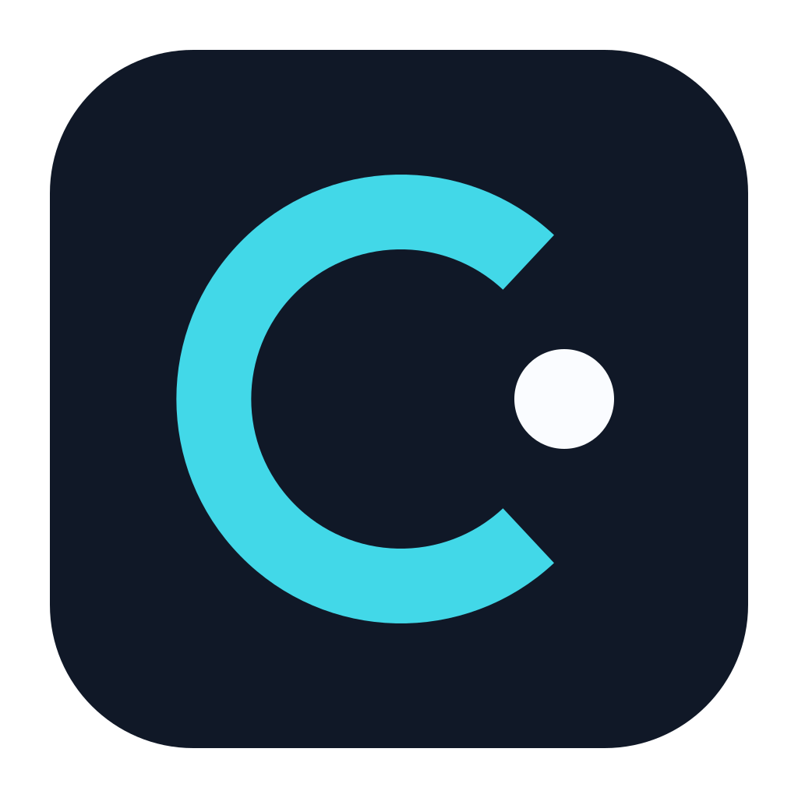

# CyberMe



个人 AI 工作区，连接对话、收件箱、灵感、任务与记忆。macOS 客户端基于 MyGO，业务状态保存在本机 SQLite；外部服务的使用取决于用户配置和授权。

[下载 CyberMe](https://github.com/wherexml/CyberMe-updates/releases/latest) · [公开规格](docs/public/README.md)

## 本地开发

需要 Node.js 22.19+ 与 npm：

```sh
npm ci
npm run dev
```

Web 使用 `46100`，API 使用 `46110`。`npm run build` 执行类型检查与 Web 构建。macOS 构建入口为 `scripts/mygo-build.mjs`，需要 macOS、Go 工具链及相关本机依赖；发行签名和公证凭据不在仓库中。

模型与连接在设置中配置；`.local/`、`data/`、环境文件和凭据均不提交。首次运行若存在姊妹项目来源，后端可能执行只读导入；请在自己的独立工作目录运行。

## 能力与意图

设置 → 通用 → 能力与意图，查看能力目录、捕获来源、历史记录和关联任务的当前进度。注册、配置、启用与实际执行结果分别展示；生成建议或创建待办不等于任务完成。

更新在后台检查和下载，校验后由用户确认重启；没有新版本时不显示左下角更新按钮。下载仓库独立于源码仓库。

## 公开范围

本仓库包含清理后的源码历史和公开文档。业务资料、运行日志、真实验收截图、私有配置及历史内部文档不随源码发布。原项目历史另有私有备份；请不要将旧历史合并回本仓库。
